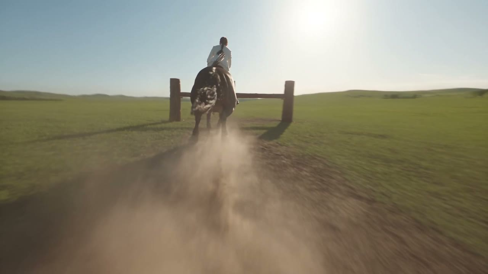
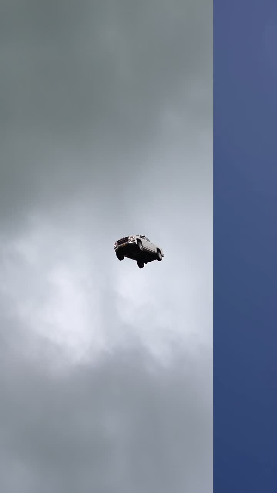
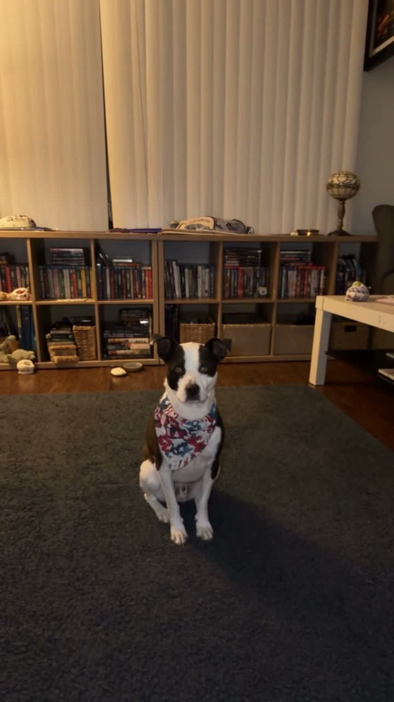
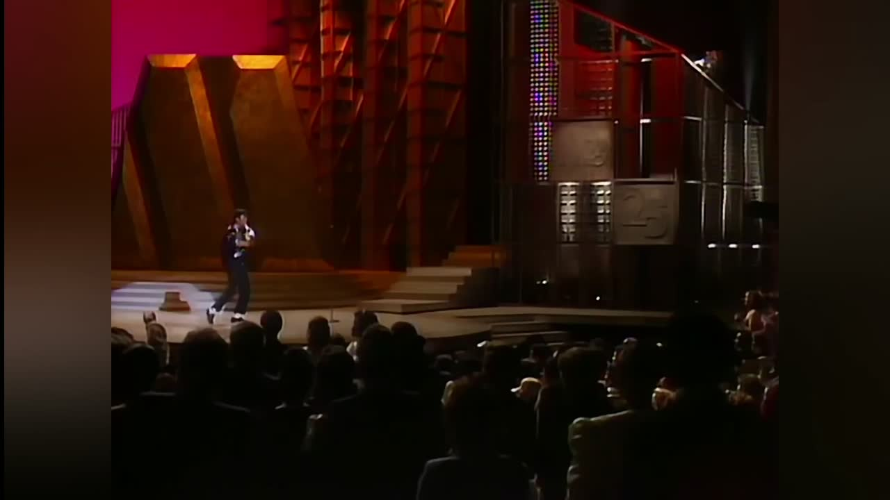
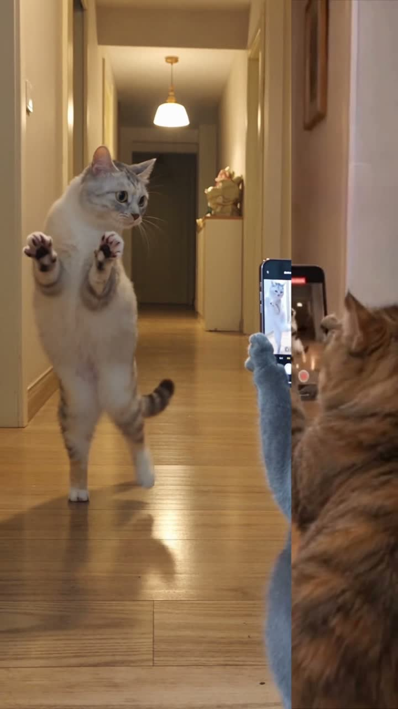
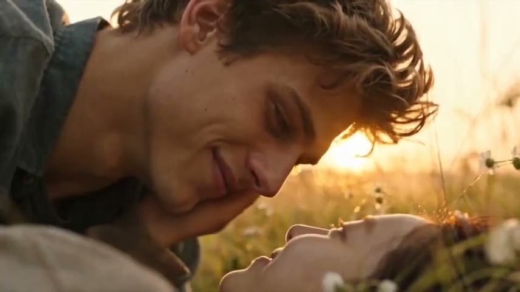
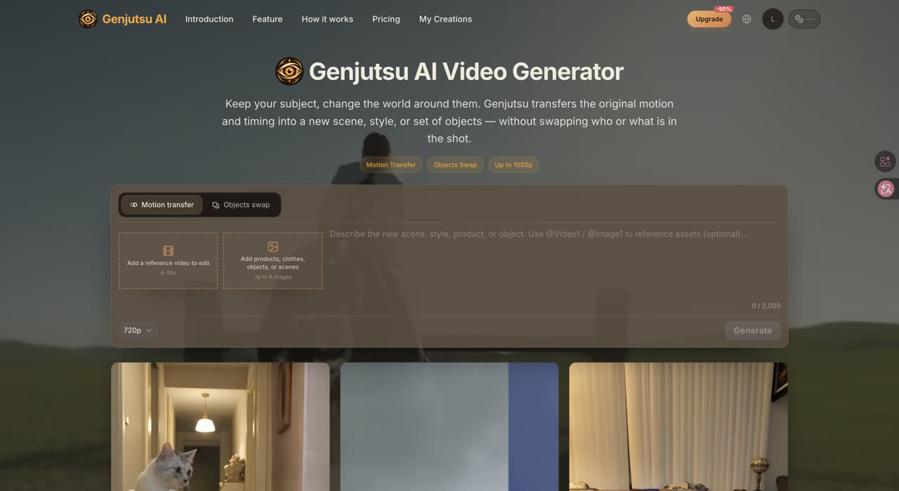
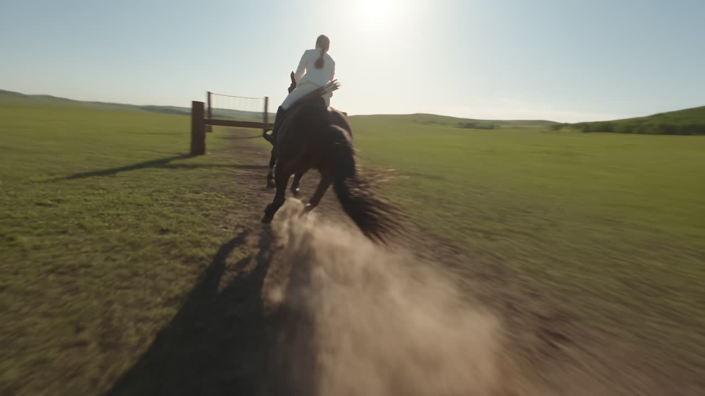

# Genjutsu AI — Replace Any Object in Your Video

**Live site:** [https://genjutsuai.net](https://genjutsuai.net)

  

Genjutsu AI restyles a real clip while keeping the same subject and motion. Swap **any object** in the frame — products, props, furniture, clothes, cars, backgrounds — without rebuilding the shot from scratch.

Use the home generator for free-form Object Swap / Motion Transfer, or follow the guided tools below for viral formats.

---

## What You Can Do

| Mode | Best for |
| --- | --- |
| **Object Swap** | Replace *anything* in the video: a bottle → your product, a sofa → a new design, a prop → a brand asset |
| **Motion Transfer** | Keep the camera path and timing, change the world around the subject |
| **Hotel Lobby AI** | Turn a walk-in clip into a luxury hotel lobby scene |
| **AI Zombie Hug** | Drop a zombie hug / horror-romance meme template onto your character |

  
  &nbsp;
  
  &nbsp;
  

<em>Same motion. New objects, scenes, and styles.</em>

Credits are prepaid packs — no subscription required.  
Start here: [genjutsuai.net](https://genjutsuai.net)

---

## Tutorial 1: Hotel Lobby AI

Transform an ordinary indoor walk into a cinematic hotel lobby restyle.

**Tool:** [Hotel Lobby AI](https://genjutsuai.net/hotel-lobby-ai)

  

### Steps

1. Open [Hotel Lobby AI](https://genjutsuai.net/hotel-lobby-ai).
2. Upload a short source video of a person walking through a space (clear subject, steady motion works best).
3. Confirm the estimated credits shown before generate.
4. Run the job and wait for processing (usually a few minutes).
5. Download the restyled lobby video when it completes.

### Tips

- Keep the subject readable in frame; Genjutsu preserves who is in the shot.
- Prefer clips with continuous walking motion — that motion is what gets transferred into the lobby scene.
- Higher resolution costs more credits; start at 720p if you are testing.

---

## Tutorial 2: AI Zombie Hug

Create a zombie hug / horror-romance meme video with the guided template flow.

**Tool:** [AI Zombie Hug](https://genjutsuai.net/ai-zombie-hug)

  

### Steps

1. Open [AI Zombie Hug](https://genjutsuai.net/ai-zombie-hug).
2. Upload your subject image or video as the tool prompts.
3. Pick the zombie hug template / duration options available in the UI.
4. Review the credit estimate, then generate.
5. Download when the task finishes and share the result.

### Tips

- Face-swap / identity replacement of real people is not supported — keep prompts and uploads within the product rules.
- Longer templates use more credits; check the estimate before paying.
- If credits are low, buy a pack on [Pricing](https://genjutsuai.net/pricing) (Mini starts at $9.99).

---

## Tutorial 3: Replace Any Object (Object Swap)

Use the main generator when you want full control — swap products, rooms, props, or styles in *your* footage.

**Tool:** [Genjutsu AI Generator](https://genjutsuai.net/)

  

### Steps

1. Go to [genjutsuai.net](https://genjutsuai.net).
2. Upload the source video.
3. Choose **Objects Swap** (or Motion Transfer for full-scene restyles).
4. Add reference images if you want a specific product / look.
5. Write a clear prompt: what to keep, what to replace (e.g. “replace the coffee cup with a silver thermos, keep the person’s hands and motion”).
6. Pick resolution → confirm credits → generate → download.

  

### Prompt ideas for object replacement

- Replace a drink / bottle with your SKU while keeping the hand motion.
- Swap furniture or wall art in a room tour without re-shooting.
- Change a prop or costume piece in an action clip; leave the performer unchanged.
- Restyle the environment around a pet or character while locking identity.

---

## Pricing (quick)

One-time packs on [Pricing](https://genjutsuai.net/pricing): Mini, Starter, Creator, Studio. Credits are calculated per generation from duration and resolution.

---

## More on the site

- [Home / Generator](https://genjutsuai.net/)
- [Hotel Lobby AI](https://genjutsuai.net/hotel-lobby-ai)
- [AI Zombie Hug](https://genjutsuai.net/ai-zombie-hug)
- [Pricing](https://genjutsuai.net/pricing)
- [Blog](https://genjutsuai.net/blog)
- [Terms of Service](https://genjutsuai.net/terms-of-service)

---

## About this repository

Public **build artifacts** for the live product at [https://genjutsuai.net](https://genjutsuai.net). This repo does not include application source code.
